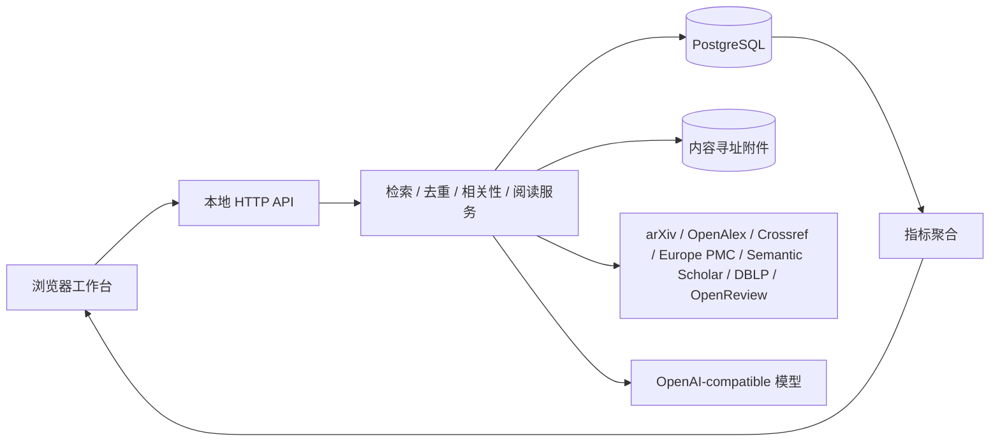

# LitLoom：研究生论文工作台工程化架构说明

版本：0.19.0，PostgreSQL schema 19
定位：个人优先、可迁移、可审计的研究文献工作台。项目同时展示一个完整的软件工程闭环：需求分析、模块设计、数据采集、质量控制、指标分析、反馈学习、备份恢复和迭代发布。

## 1. 项目价值

论文工具最容易失败在两个地方：搜索结果没有长期记忆，AI 结论无法回到原始证据。本项目把“发现、分诊、阅读、反馈、复盘”建成一个持久化工作流。Agent 负责重复劳动，研究者保留判断权；任何自动结果都带来源、时间和可解释理由。

当前版本已经具备：

成熟 Agent 项目和中间件的核对、接入边界与升级门槛见 [`AGENT_ECOSYSTEM.md`](AGENT_ECOSYSTEM.md)。当前策略是把官方学术 API、持久化 DAG、OpenAI-compatible 模型和 MCP 工具边界组合起来，避免为每个能力增加一个不可审计的运行时依赖。

- arXiv / OpenAlex / Crossref / Europe PMC / Semantic Scholar / DBLP / OpenReview 联邦检索、研究维度识别、中英文桥接、多路召回、来源加权 RRF、近题名去重、MMR 多样性重排、来源快照和定时主题追踪；DBLP/OpenReview 为可选连接器，单独失败不会阻断其他来源；
- 精准/平衡/深度查询计划，综述/基准/数据集评测/失败分析/前沿入口，作者/venue/年份/文献类型过滤，相关性/新近性/新发现/经典/邻域探索排序，以及引用/被引/相似论文扩展；
- AI 工具检索使用标准 OpenAI-compatible function calling：模型拆解研究问题、自主选择查询角度和适配的学术来源，LitLoom 并行执行现有连接器；配置了 Tavily 时还可执行受限联网发现，但每条网页线索必须经过 DOI、arXiv、Crossref 或 OpenAlex 核验，未核验项只能作为 uncertain 线索。所有带来源候选再交回模型筛选；支持 Chat Completions 与 Responses，不依赖模型端点内置网页搜索。检索轮数有上限，历史去重、失败诊断和候选确认沿用主搜索流程；
- 主题级相关性评分、首次/最近出现、出现次数和用户反馈；
- 发现候选队列与馆藏分离：单次搜索和手动运行保存主题只生成可恢复候选；AI 只分析有限元数据并给出相关性建议，导入始终由用户显式确认；搜索历史可恢复/重搜，反馈按研究意图记忆并支持撤销；
- 忽略反馈抑制重复推荐，相关反馈影响同主题后续排序；
- 研究画像推荐：并行调用 OpenAlex `related_works` 与 Semantic Scholar hosted recommendations 产生外部信号，并作为馆藏内候选的排序信号；两家服务的外部候选统一展示并保留 provider 来源，结合已读、收藏、主题反馈和重复次数；外部刷新异步且有缓存，单个 provider 失败不阻断其他 provider，没有学术标识时回退本地画像；外部候选只有用户确认后才进入文献库，provider 分数不代表论文质量；
- OpenAI Chat Completions 兼容模型配置和连接测试；
- 可选任务模型路由：检索、初筛和元数据任务可使用快速模型，全文阅读与证据综合可使用分析模型，多模态页面分析可使用视觉模型；它们共用已配置的 OpenAI 兼容端点和 API Key。留空时沿用主模型；产物身份记录实际分析/视觉模型，避免换模型后复用旧分析；
- OpenAlex 参考文献线索同步；
- PostgreSQL `pg_dump` 备份、ZIP manifest、SHA-256 校验和恢复；
- 数据分析页：馆藏、积压、阅读吞吐、来源健康、去重率和 12 周趋势。
- PostgreSQL `pg_trgm` 子串索引覆盖论文元数据、标签、笔记、结构化阅读卡和逐页 PDF 文本；索引是可重建派生数据。
- 论文页内证据检索使用 PostgreSQL `pg_trgm` 召回并执行本地词法排序，保留受控中英文术语桥接和稳定字符偏移锚点；可选 OpenAI 兼容 Embeddings 按页分块建立持久索引，再以倒数排名融合词法和语义候选。索引保存模型/端点身份、文本哈希、向量维度和页内偏移；文本改变后识别过期页面，后台任务支持进度、取消、部分失败重试和重启续跑。未配置、未索引或 Embedding 请求失败时明确回退词法检索。
- 服务器端分页文献库、稳定排序、收藏/阅读卡/年份过滤、匹配字段和片段，避免浏览器随馆藏增长全量加载。
- 笔记与阅读卡版本快照、恢复和导入导出；同步作业持久化阶段、尝试次数、重试时间和重启中断状态。
- 本地研究简报：从最近窗口、主题、运行记录和研究画像生成可复现的下一步阅读队列，不依赖模型调用。
- 运维基础设施：带请求 ID 和 `duration_ms` 的结构化请求日志、审计事件、健康/就绪检查、备份与同步的可追踪运行指标。
- 运行时 SLO：`/api/metrics` 聚合请求量、4xx/5xx、p50/p95 延迟和热点路由；只保留最近 500 个耗时样本，重启后重新建立窗口，不把原始请求写入数据库。
- 开发优化闭环：`/api/analytics` 同时返回检索漏斗、反馈/Precision 样本、观察窗口、质量门禁和 P1/P2/P3 优化动作；数据分析页把事实指标直接连接到下一轮查询、排序、连接器和性能改进。运行详情单独持久化，旧运行会明确标记为历史详情缺失。
- PDF 原文证据层：逐页文本、提取质量、文本哈希和页码检索；解析结果作为可重建派生数据保存。

## 2. 系统边界



代码采用模块化单体，而不是拆成微服务。`app.py` 是启动与兼容门面，HTTP、检索、PDF、分析、任务和 Agent 实现分别位于 `literature_desk/` 的领域模块中。当前兼容层通过 `literature_desk/services.py` 将模块依赖绑定到应用组合入口，避免模块之间互相导入，也保留旧的 `import app` 调用、测试替身和扩展点；新模块应优先使用显式参数/端口，逐步减少兼容服务定位器。后台线程通过上下文传播保留请求与工作区边界。**当前运行后端为 PostgreSQL；SQLite 仅保留为迁移导入和兼容测试后端。**当前 PostgreSQL 部署是共享工作区，不代表已完成 PostgreSQL 行级租户隔离。

主要代码边界：

| 模块 | 职责 |
|---|---|
| `literature_desk/model_runtime.py` | 模型配置、OpenAI 兼容请求、限流、遥测 |
| `literature_desk/workspaces.py` / `database.py` / `postgres.py` | PostgreSQL 连接、启动迁移、SQLite 兼容导入与工作区认证边界 |
| `literature_desk/library.py` | 论文身份、馆藏、推荐、备份 |
| `literature_desk/documents.py` / `paper_analysis.py` | PDF 导入、页级文本/向量索引、阅读卡和精读 |
| `literature_desk/providers.py` / `discovery.py` | 学术来源适配器、联网线索、查询规划和候选筛选 |
| `literature_desk/jobs.py` | 持久任务、后台执行器与调度 |
| `literature_desk/research_agents.py` | 研究目标、工具执行、Agent 工作流与恢复 |
| `literature_desk/analysis.py` | 摘要助读和结构化结果整理 |
| `literature_desk/web/handler.py` | HTTP 路由、认证边界和 API 请求适配 |
| `literature_desk/services.py` | 兼容绑定；新代码应避免新增对全局门面的依赖 |

前端资源按 `static/js/` 中的页面视图、检索、文献库、阅读和交互处理拆分，`static/app.js` 保留共享状态与 API/会话启动。为兼容当前无构建链的浏览器端代码，脚本仍按固定顺序作为 classic scripts 加载，共享状态仍是待逐步收敛的耦合点；新增交互应优先通过单一状态/API 边界协作，后续可逐块改为带显式导入导出的 ES modules。

## 3. 技术选择与取舍

| 决策 | 选择 | 原因 | 后续扩展 |
|---|---|---|---|
| 服务端 | Python 标准库 + ThreadingHTTPServer | 零依赖、易审计、Windows 一键启动，适合个人本地部署 | 规模扩大时迁移 FastAPI / worker，保持 API 契约 |
| 主数据库 | PostgreSQL；SQLite 仅用于旧数据导入与兼容测试 | PostgreSQL 用于并发、约束和长期运行；SQLite 保留数据兼容 | 见 ADR-006；PostgreSQL 当前限共享工作区，租户 RLS 尚待实现 |
| 附件 | 文件系统 + SHA-256 | PDF 不进入数据库 BLOB，重复文件可识别，备份可校验 | 对象存储或加密同步 |
| 检索来源 | 官方 API / Atom / REST | 避免脆弱页面抓取和账号依赖，保留 source record；Europe PMC 补充医学/生命科学，Semantic Scholar 补充语义覆盖，OpenReview 补充会议投稿 | 增加 PubMed、ACL 和更细的学科源 |
| 前端 | 原生 HTML/CSS/JS | 无构建链、离线友好、长期维护成本低 | 复杂协作场景可迁移 React，保留后端接口 |
| 发布包 | `pyproject.toml` + wheel/sdist | 统一版本、可安装命令、静态资源和文档随包分发 | 接入签名发布与制品仓库 |
| 模型协议 | OpenAI Chat Completions 兼容格式 | 服务商可替换，支持云模型和本地兼容服务 | Responses API / 本地模型 adapter |
| 相关性 | 可复现规则 + 主题反馈 | 可解释、无需上传全文，便于建立可测 baseline | 本地多语言 embedding 重排，并保留规则证据 |

## 4. 核心数据模型

- `papers`：研究工作主记录，保存人工状态、笔记和规范元数据。
- `source_records`：来源原始快照、外部 ID、检索主题和抓取时间；来源刷新不会覆盖人工笔记。一次检索同时保留原始问题、概念变体和命中路径，便于复核召回来源。
- `saved_queries`：可暂停的主题检索计划。
- `saved_queries.search_options_json`：持久化作者、venue、年份、文献类型、检索深度、发现模式和重复抑制策略，保证自动追踪与手动搜索使用同一套规则。
- `runs`：每次同步的状态、来源列表、来源级抓取/过滤/接受详情、错误、新增数和重复数。`source_details_json` 从 schema 7 开始写入，旧运行保留兼容但不伪造漏斗数据。
- `discovery_candidates`：与 `papers` 分离的候选队列；保留原始候选、稳定身份和是否由用户导入，刷新页面不丢失。
- `discovery_triage_jobs`：候选 AI 元数据初筛的持久状态和进度；AI 注解保存在候选记录中，重启中断后可见并重试。
- `discovery_candidate_feedback`：按研究意图和论文稳定身份保存相关/不相关/跳过及撤销标记，避免临时候选 UUID 导致重复推荐。
- `query_matches`：`query_id + paper_id` 的主题记忆，保存分数、解释、首次/最近出现、出现次数和用户决定。
- `citation_edges`：来源论文到外部参考文献 ID 的关系及 provider provenance。
- `attachments`：本地 PDF 的哈希、大小和文件名。
- `ai_artifacts`：模型、提示版本、输入哈希和输出，确保 AI 结果可审计。
- `reading_cards`：每篇论文一张结构化阅读证据卡，记录问题、贡献、方法、结果、局限、可复现性、证据定位、个人启发和下一步；与自由笔记并存并可迁移。
- `model_config`：只保存 OpenAI 兼容连接参数和启用状态，不保存 API Key。
- `learning_feedback`：保存全局推荐的相关/不相关判断，与主题级 `query_matches` 分开，避免跨主题误伤。
- JSON 导入导出会保留候选搜索历史、初筛进度和跨次反馈；完整 ZIP 备份另含 PDF 文件。
- `audit_events`：记录不含密钥的创建、更新、同步、反馈、备份事件，支持问题定位和产品指标回放。
- `document_pages`：本地 PDF 的逐页提取结果、质量标签、提取器版本和文本哈希；它不是替代原 PDF 的权威原件。

相关性放在 `query_matches` 而不是 `papers`，因为同一篇论文对不同研究主题的相关性和用户判断可能不同。

## 5. 数据驱动的开发闭环

### 5.1 事件与指标

每次检索和阅读动作先产生结构化事实，再由分析接口聚合。核心指标定义如下：

- **阅读吞吐**：指定时间内从 `reading/to_read` 变为 `read` 的论文数。
- **积压量**：`inbox + to_read + later`。
- **来源成功率**：成功 source observations / 全部 source observations。
- **相关度闭环**：召回和评分共享同一套中英文桥接词表；中文短语使用低权重 bi/tri-gram 增强召回；跨来源结果使用来源加权 Reciprocal Rank Fusion，并用 MMR 控制首屏多样性；全局反馈、主题反馈和馆藏邻域扩展分别记录，便于区分“检索不到”“检索到了但排序靠后”和“已经看过”。
- **检索覆盖**：一次运行的原始抓取量、过滤量、去重量和最终候选量；同时记录概念变体、扩展开关和每个来源的分路结果，用于判断是来源召回不足、过滤过严还是重复较多。
- **去重率**：重复命中数 /（新增数 + 重复命中数）。
- **反馈覆盖率**：有 `relevant/irrelevant/ignored` 决定的主题匹配数 / 全部主题匹配数。
- **推荐质量抽样**：每周随机抽取高相关、邻近、低相关候选，由用户标注后计算 precision@k；当前 OpenAlex 关系信号与本地反馈融合仍是可解释排序基线，不把分数冒充科学结论。
- **检索质量评测**：`/api/evaluation` 从 `query_matches` 的明确相关/忽略反馈计算宏平均 Precision@5、Precision@10、样本量和每主题明细；样本不足时明确标记，不输出伪精确指标。
- **离线回归评测**：`scripts/evaluate_retrieval.py` 使用 `literature_desk.evaluation` 读取固定 JSON 标注集，计算 Precision@k、Recall@k、MRR 并排除无标签样本；它不联网、不调用模型，适合在更换 connector、排序权重或提示版本后比较同一批案例。
- **运行时 SLO**：`/api/metrics` 从进程内有界窗口计算请求量、4xx/5xx 错误率、p50/p95 延迟和热点路由；它与业务数据分开，既能指导性能优化，也不会把请求原文或敏感数据写入数据库。
- **版本与灰度**：`/api/diagnostics` 的 release 区域暴露应用/schema/契约版本和可选 canary 分桶；`literature_desk.release` 使用盐值和 workspace 稳定哈希，默认关闭实验特性，避免刷新或重启改变用户分组。实验功能仍必须保留旧路径和回滚开关。

数据分析页直接读取本地数据库，展示近 30 天 KPI、来源健康、主题分布和 12 周新增/读完趋势。指标用于调整策略：积压连续增长时降低同步频率或提高筛选阈值；来源失败率上升时暂停该来源；相关反馈覆盖率不足时优先做人工分诊，而不是盲目接入更大的模型。

### 5.2 迭代流程

1. **需求**：从研究工作流和失败案例定义可验收行为。
2. **Baseline**：先用可解释规则、强 ID 去重和开放 API，建立稳定数据集。
3. **Instrumentation**：记录 run、source、query match、反馈和 AI artifact。
4. **Evaluation**：跑单元测试、HTTP 集成测试、备份恢复测试，并观察分析指标。
5. **Controlled improvement**：一次只变更一个评分或 connector 版本，保留 `score_version` 和原始来源。
6. **Release**：数据库迁移、备份演练、变更说明、回滚路径确认后再发布。

## 6. 研究目标 Agent 编排

研究目标是长期记忆的根实体。每次运行会持久化一份带输入契约、输出契约、完成条件、失败策略、预算和依赖关系的 DAG 计划；运行器按依赖执行，遇到可重试错误自动重试，遇到预算、死锁或未满足依赖会明确结束为 `partial`，不会把未执行步骤误报成成功；停止条件未满足时最多执行一轮持久化证据收敛，结果通过 `budget.completion_state=partial` 和阻塞原因暴露给 UI。服务重启会把运行恢复为 `interrupted`，用户可以继续失败步骤。

新建目标默认使用本地意图路由器选择 `research_map`、`evidence_review` 或 `follow_up`，并把命中的意图信号和选择理由写入目标及运行计划；这一轻量步骤不调用模型。用户可以手动覆盖路由。可选定期执行仅支持 `follow_up`，首次到期时间从创建时按所选频率计算；周期任务比较稳定身份下的新增、变化和重复论文，不会重复发起全文精读，也不会自动导入候选。

三类工作流共享同一条可审计链路：所有工作流先按“候选检索 → `resolve_paper_identity` 身份解析 → `merge_paper_versions` 版本合并 → 分层 → 覆盖评估 → 一轮补搜 → 一轮 `expand_citations` 引用/被引/相似扩展”推进；引用扩展只读 OpenAlex、只返回候选快照，不自动把结果写入文献库。`research_map` 负责研究地图和阅读路线，`evidence_review` 严格按“全文准备 → 页级提取 → OCR 降级 → Claim/Evidence → 核验 → 批判 → 补证据 → 再核验 → 比较 → 补比较字段 → 重建最终矩阵 → 最终核验/批判”推进，`follow_up` 使用独立的 `track_follow_up`/`FollowUpAgent` 将本次候选和目标历史比较，只报告稳定身份意义上的新增论文、元数据变化和版本关系，并把重复命中单独保留。每次检索最多执行一轮覆盖补搜和一轮引用扩展，并在 `evaluate_coverage` 中保存候选、摘要、全文和关注维度的覆盖统计。补搜会生成新的临时候选 ID，但后续每个阶段都使用 DOI、规范化 arXiv ID 或保守的题名键折叠同一工作，避免重复论文污染全文缺口、Claim、比较表、阅读路线和最终产物。产物生成后还会执行 `check_citation_completeness` 和 `evaluate_stop_conditions`，把“哪些结论缺 Claim、哪些问题仍需全文核对、当前是否达到停止条件”作为运行步骤保存，而不是只显示一段无法审计的摘要。

检索的来源网络请求默认并行，单来源限流和失败仍分别记录；过滤、强标识/近题名去重、版本合并和排序保持确定性阶段，最终写入 PostgreSQL 事务。这样可以降低多源检索的墙钟时间，同时不牺牲结果可复现性；严格限流环境可通过请求选项关闭 `parallel_sources`。

身份层先用 `resolve_paper_identity` 读取本地 DOI、规范化 arXiv ID 和题名/年份匹配，显式返回 `doi`、`arxiv`、`title` 或 `unresolved`，再由 `merge_paper_versions` 通过强标识和保守标题相似度建立版本组；`research_goal_papers` 记录首次发现、最近发现、出现次数、阅读状态和用户判断，`paper_version_links` 记录预印本、会议版和期刊版关系。候选默认只进入 Agent 快照，不自动写入文献库；用户勾选引用扩展候选时，导入入口会从运行快照恢复其原始记录后再单篇写入。

证据层按研究问题将摘录标记为 `research_question`、`method`、`dataset`、`result` 或 `limitation`，`verify_evidence` 区分摘要证据和全文页码证据。比较矩阵由 `resolve_comparison_gaps` 对缺失的方法、数据集、基线或结果回查本地页级文本；补回的 Claim 会再次执行 `compare_papers`、`verify_evidence` 和 `CriticAgent`，因此最终产物不会继续复用补证据前的旧矩阵。摘录从完整页面文本连续截取，保留页码、章节和文本哈希，之后可重新验证。没有本地全文的候选只记录为未解决缺口。用户可在候选中勾选已经导入文献库的论文，通过独立确认调用公开 PDF 下载；下载器执行 HTTPS、大小、PDF 魔数和 SHA-256 去重校验，绝不因为下载而自动导入候选。`CriticAgent` 将证据边界、反例、实验设计缺陷和过度外推保存为可追踪的批判记录。最终产物同时保存候选、版本组、Claim、Evidence、批判和不确定性，支持后续导出、比较和复盘。

全文综述工作流在页级提取后执行受限 OCR 步骤：只查询 `low`/`empty` 页、最多 24 页、最多处理 8 篇本地论文；依赖缺失或 OCR 没有改善时返回明确状态，不影响正常文本页，也不会把未经核验的 OCR 输出标为高置信证据。多篇 PDF 的文本提取使用最多 3 个工作线程并行，步骤进度仍按完成数持久化，输出按输入顺序恢复以保证可复现。搜索步骤使用 PlannerAgent 持久化的查询变体和来源角色执行，查询计划因此是检索执行输入，而非只供界面展示。

Agent 可以生成检索式、抓取候选、去重、排序、提取证据、批判和生成摘要草稿。可选的 `/api/discover/agent-plan` 只发送当前查询与研究维度，模型建议会被标记为待确认检索表达，不会直接写库。Agent 不会未经确认删除论文、覆盖笔记、写入阅读卡、下载外部 PDF 或导出外部报告。Apply/External 工具在运行器边界统一停在 `awaiting_confirmation`，批准后才会恢复。模型配置页面允许用户切换 OpenAI 官方服务或兼容服务；发送摘要前仍需逐篇同意。

`draft_reading_card` 复用持久化 AI 任务系统执行真实全文分析，不再生成摘要占位文本：快速阅读卡只逐页处理 PDF 文字，以较大的内容块减少模型往返；同一模型请求还会生成读前准备，包括必要先修概念、专业术语、符号速查和短自测，不渲染或发送页面图像，也不增加额外模型往返。术语原文依据须能在本地页文本中逐字找到；模型推断的背景知识会单独标识。深度精读才使用视觉页预算，分析公式、图表和算法，并补充结果表格与批判性分析。运行时有全局模型请求预算、单任务队列、PDF 渲染信号量和分块/汇总独立输出上限；视觉页面使用磁盘缓存，分块完成后立即丢弃 Base64 图像数据，避免长论文的内存随页数线性增长。视觉产物保留页码证据并明确抽样边界。任务 ID、阶段、进度、耗时、失败原因和重启中断状态均会保存；产物另外记录模型请求次数、每次响应耗时、视觉页覆盖率，便于判断瓶颈位于模型往返还是本地准备。只有 `completed` 才能满足步骤完成条件，未配置模型、没有本地 PDF 或任务失败会作为明确缺口保留。全文输入会计算来源指纹并结合模型/协议/端点、模板和流水线版本复用历史 artifact，避免刷新或重复点击再次计费；模型输出默认有界且默认流式接收，兼容网关不支持这些可选参数时自动降级。

成功的阅读卡/精读还会把 `prereading_guide` 拆成按论文、类型和规范化条目键唯一的 `study_items`。定义更新使用 upsert，但不覆盖用户的掌握状态或个人备注；条目保留定义来源、必要性、页码短引文和分析 artifact 标识。知识页支持搜索、分页、类型/状态过滤、掌握状态更新、个人理解备注和删除。到期复习使用本地间隔调度，条目可按“忘了/困难/记住/轻松”自评，安排后续复习并记录连续记忆、间隔、遗忘次数和难度系数；模型不参与复习调度。数据迁移映射论文 ID 并保留学习状态与复习计划；schema 18 对旧库只增加带默认值的复习字段，不改写已有笔记；完整归档由 PostgreSQL dump 与附件组成。

## 7. 可靠性与安全

- 服务默认绑定 `127.0.0.1`，不暴露局域网。
- API Key 按“当前进程、本地密钥文件、环境变量”的顺序读取；本地文件默认位于数据目录，也可由 `LIT_AGENT_API_KEY_FILE` 指定。密钥不写 PostgreSQL、日志或备份，设置接口只返回存在性和来源。
- 外部 URL 使用超时、User-Agent、错误分类和定时重试；部分失败不会伪装成“没有新论文”。
- PostgreSQL 使用事务和 `pg_dump` 一致性备份；归档包含 manifest、哈希和附件清单。SQLite WAL/online backup 仅用于兼容测试和旧库迁移。

PostgreSQL 当前仅支持 `LITLOOM_TENANT_MODE=shared`。配置 `isolated` 会被拒绝，避免 SQLite 文件式隔离逻辑错误地应用到 PostgreSQL；待 RLS、事务级工作区上下文与跨租户集成测试完成后再开放 PostgreSQL 隔离模式。
- 所有外部数据都经过长度限制、路径校验和 HTML 清理；PDF 附件按内容哈希保存。
- AI 结果保存模型、提示版本和输入哈希，不能作为原始论文证据的替代。

## 8. 质量门槛

```powershell
python -m unittest discover -s tests -v
python -m py_compile .\app.py .\tests\test_app.py
```

发布前至少确认：去重幂等、主题反馈抑制、来源分页、联邦检索过滤与排序、OpenAlex 引用幂等、研究画像反馈抑制、跨主题关联、模型 Key 不入库、分析指标可复算、备份可恢复、页面 API 返回 200、Embedding 响应校验/索引幂等/文本变更失效/混合排序和 BM25 降级。语义检索发布前还应使用人工相关性标注集持续评测 recall、MRR 与跨语言查询质量。

## 9. 下一阶段

1. 为语义检索建立带人工标注的中英文离线集，评测 recall@k、MRR 和混合排序参数，并按用户反馈迭代。
2. 在现有 PDF 逐页文本层上加入 OCR、页码级笔记和证据问答；无法定位时明确降级。
3. OpenAlex 前向引用、未解析目标解析和跨版本关系。
4. Zotero 单向导入/导出、周报、浏览器剪藏和加密跨设备同步。
5. 完成 PostgreSQL RLS 隔离与独立 worker 的可选团队部署版本。

这个顺序保留了一个重要原则：先让数据和证据可靠，再让模型变得更聪明。

论文详情支持结合逐页文字与 PyMuPDF 页面渲染的多模态阅读卡和精读，覆盖公式、表格、曲线、流程图和嵌入图像，并为视觉事实保留附件/页码锚点。文字引文在本机验证；视觉输入摘要纳入结果哈希，模型拒绝图像或缺少渲染器时记录降级原因。生成阅读卡默认只应用到空字段，人工字段与历史快照保持可追溯。多人部署、身份与工作区隔离、标准 `src/` 代码结构和跨论文证据比较的目标设计见 [`MULTIUSER_PLATFORM_DESIGN.md`](MULTIUSER_PLATFORM_DESIGN.md)；当前 0.19.0 使用本机 PostgreSQL 共享工作区，网络团队部署与租户隔离仍未完成。
