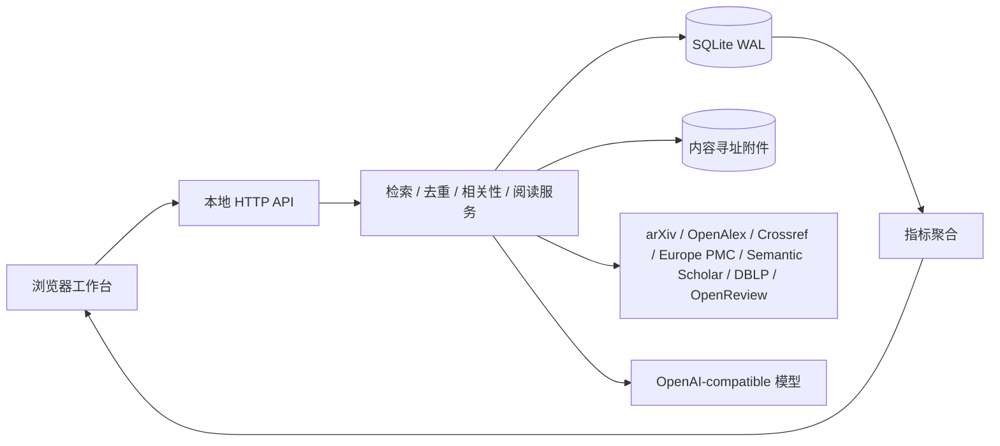

# 研究生论文工作台：工程化架构说明

版本：0.15.0，数据库 schema 9  
定位：个人优先、可迁移、可审计的研究文献工作台。项目同时展示一个完整的软件工程闭环：需求分析、模块设计、数据采集、质量控制、指标分析、反馈学习、备份恢复和迭代发布。

## 1. 项目价值

论文工具最容易失败在两个地方：搜索结果没有长期记忆，AI 结论无法回到原始证据。本项目把“发现、分诊、阅读、反馈、复盘”建成一个持久化工作流。Agent 负责重复劳动，研究者保留判断权；任何自动结果都带来源、时间和可解释理由。

当前版本已经具备：

- arXiv / OpenAlex / Crossref / Europe PMC / Semantic Scholar / DBLP / OpenReview 联邦检索、研究维度识别、中英文桥接、多路召回、来源加权 RRF、近题名去重、MMR 多样性重排、来源快照和定时主题追踪；DBLP/OpenReview 为可选连接器，单独失败不会阻断其他来源；
- 精准/平衡/深度查询计划，综述/基准/数据集评测/失败分析/前沿入口，作者/venue/年份/文献类型过滤，相关性/新近性/新发现/经典/邻域探索排序，以及引用/被引/相似论文扩展；
- 主题级相关性评分、首次/最近出现、出现次数和用户反馈；
- 忽略反馈抑制重复推荐，相关反馈影响同主题后续排序；
- 研究画像推荐：综合已读、收藏、主题反馈和重复次数，输出下一步论文及跨主题关联；
- OpenAI Chat Completions 兼容模型配置和连接测试；
- OpenAlex 参考文献线索同步；
- SQLite 在线备份、ZIP manifest、SHA-256 校验和恢复；
- 数据分析页：馆藏、积压、阅读吞吐、来源健康、去重率和 12 周趋势。
- SQLite FTS5 本地全文索引覆盖论文元数据、标签、笔记、结构化阅读卡和逐页 PDF 文本；索引是可重建派生数据，FTS5 不可用时自动降级到字段检索。
- 服务器端分页文献库、稳定排序、收藏/阅读卡/年份过滤、匹配字段和片段，避免浏览器随馆藏增长全量加载。
- 笔记与阅读卡版本快照、恢复和导入导出；同步作业持久化阶段、尝试次数、重试时间和重启中断状态。
- 本地研究简报：从最近窗口、主题、运行记录和研究画像生成可复现的下一步阅读队列，不依赖模型调用。
- 运维基础设施：带请求 ID 和 `duration_ms` 的结构化请求日志、审计事件、健康/就绪检查、备份与同步的可追踪运行指标。
- 运行时 SLO：`/api/metrics` 聚合请求量、4xx/5xx、p50/p95 延迟和热点路由；只保留最近 500 个耗时样本，重启后重新建立窗口，不把原始请求写入数据库。
- 开发优化闭环：`/api/analytics` 同时返回检索漏斗、反馈/Precision 样本、观察窗口、质量门禁和 P1/P2/P3 优化动作；数据分析页把事实指标直接连接到下一轮查询、排序、连接器和性能改进。运行详情单独持久化，旧运行会明确标记为历史详情缺失。
- PDF 原文证据层：逐页文本、提取质量、文本哈希和页码检索；解析结果作为可重建派生数据保存。

## 2. 系统边界



代码采用模块化单体，而不是早期拆成微服务。个人文献库的主要瓶颈是数据正确性、来源可追溯和恢复可靠性，不是服务间吞吐；单体可以用事务保护跨表操作，也更容易离线运行。当前 HTTP 入口保留在 `app.py` 以便零依赖启动，稳定的领域词汇已经下沉到 `literature_desk/domain.py`；后续可沿同一边界继续拆出 connector、scheduler 和 AI service worker，而不改变 API 契约。

## 3. 技术选择与取舍

| 决策 | 选择 | 原因 | 后续扩展 |
|---|---|---|---|
| 服务端 | Python 标准库 + ThreadingHTTPServer | 零依赖、易审计、Windows 一键启动，适合个人本地部署 | 规模扩大时迁移 FastAPI / worker，保持 API 契约 |
| 主数据库 | SQLite + WAL + 外键 | 单文件可备份、事务可靠、个人多年数据足够；WAL 提升读写并发 | 需要多人协作时迁移 PostgreSQL |
| 附件 | 文件系统 + SHA-256 | PDF 不进入数据库 BLOB，重复文件可识别，备份可校验 | 对象存储或加密同步 |
| 检索来源 | 官方 API / Atom / REST | 避免脆弱页面抓取和账号依赖，保留 source record；Europe PMC 补充医学/生命科学，Semantic Scholar 补充语义覆盖，OpenReview 补充会议投稿 | 增加 PubMed、ACL 和更细的学科源 |
| 前端 | 原生 HTML/CSS/JS | 无构建链、离线友好、长期维护成本低 | 复杂协作场景可迁移 React，保留后端接口 |
| 发布包 | `pyproject.toml` + wheel/sdist | 统一版本、可安装命令、静态资源和文档随包分发 | 接入签名发布与制品仓库 |
| 模型协议 | OpenAI Chat Completions 兼容格式 | 服务商可替换，支持云模型和本地兼容服务 | Responses API / 本地模型 adapter |
| 相关性 | 可复现规则 + 主题反馈 | 可解释、无需上传全文，便于建立可测 baseline | 本地多语言 embedding 重排，并保留规则证据 |

## 4. 核心数据模型

- `papers`：研究工作主记录，保存人工状态、笔记和规范元数据。
- `source_records`：来源原始快照、外部 ID、检索主题和抓取时间；来源刷新不会覆盖人工笔记。一次检索同时保留原始问题、概念变体和命中路径，便于复核召回来源。
- `saved_queries`：可暂停的主题检索计划。
- `saved_queries.search_options_json`：持久化作者、venue、年份、文献类型、检索深度、发现模式和重复抑制策略，保证自动追踪与手动搜索使用同一套规则。
- `runs`：每次同步的状态、来源列表、来源级抓取/过滤/接受详情、错误、新增数和重复数。`source_details_json` 从 schema 7 开始写入，旧运行保留兼容但不伪造漏斗数据。
- `query_matches`：`query_id + paper_id` 的主题记忆，保存分数、解释、首次/最近出现、出现次数和用户决定。
- `citation_edges`：来源论文到外部参考文献 ID 的关系及 provider provenance。
- `attachments`：本地 PDF 的哈希、大小和文件名。
- `ai_artifacts`：模型、提示版本、输入哈希和输出，确保 AI 结果可审计。
- `reading_cards`：每篇论文一张结构化阅读证据卡，记录问题、贡献、方法、结果、局限、可复现性、证据定位、个人启发和下一步；与自由笔记并存并可迁移。
- `model_config`：只保存 OpenAI 兼容连接参数和启用状态，不保存 API Key。
- `learning_feedback`：保存全局推荐的相关/不相关判断，与主题级 `query_matches` 分开，避免跨主题误伤。
- `audit_events`：记录不含密钥的创建、更新、同步、反馈、备份事件，支持问题定位和产品指标回放。
- `document_pages`：本地 PDF 的逐页提取结果、质量标签、提取器版本和文本哈希；它不是替代原 PDF 的权威原件。

相关性放在 `query_matches` 而不是 `papers`，因为同一篇论文对不同研究主题的相关性和用户判断可能不同。

## 5. 数据驱动的开发闭环

### 5.1 事件与指标

每次检索和阅读动作先产生结构化事实，再由分析接口聚合。核心指标定义如下：

- **阅读吞吐**：指定时间内从 `reading/to_read` 变为 `read` 的论文数。
- **积压量**：`inbox + to_read + later`。
- **来源成功率**：成功 source observations / 全部 source observations。
- **相关度闭环**：召回和评分共享同一套中英文桥接词表；中文短语使用低权重 bi/tri-gram 增强召回；跨来源结果使用来源加权 Reciprocal Rank Fusion，并用 MMR 控制首屏多样性；全局反馈、主题反馈和馆藏邻域扩展分别记录，便于区分“检索不到”“检索到了但排序靠后”和“已经看过”。
- **检索覆盖**：一次运行的原始抓取量、过滤量、去重量和最终候选量；同时记录概念变体、扩展开关和每个来源的分路结果，用于判断是来源召回不足、过滤过严还是重复较多。
- **去重率**：重复命中数 /（新增数 + 重复命中数）。
- **反馈覆盖率**：有 `relevant/irrelevant/ignored` 决定的主题匹配数 / 全部主题匹配数。
- **推荐质量抽样**：每周随机抽取高相关、邻近、低相关候选，由用户标注后计算 precision@k；当前规则评分是 baseline，不把分数冒充科学结论。
- **检索质量评测**：`/api/evaluation` 从 `query_matches` 的明确相关/忽略反馈计算宏平均 Precision@5、Precision@10、样本量和每主题明细；样本不足时明确标记，不输出伪精确指标。
- **运行时 SLO**：`/api/metrics` 从进程内有界窗口计算请求量、4xx/5xx 错误率、p50/p95 延迟和热点路由；它与业务数据分开，既能指导性能优化，也不会把请求原文或敏感数据写入数据库。

数据分析页直接读取本地数据库，展示近 30 天 KPI、来源健康、主题分布和 12 周新增/读完趋势。指标用于调整策略：积压连续增长时降低同步频率或提高筛选阈值；来源失败率上升时暂停该来源；相关反馈覆盖率不足时优先做人工分诊，而不是盲目接入更大的模型。

### 5.2 迭代流程

1. **需求**：从研究工作流和失败案例定义可验收行为。
2. **Baseline**：先用可解释规则、强 ID 去重和开放 API，建立稳定数据集。
3. **Instrumentation**：记录 run、source、query match、反馈和 AI artifact。
4. **Evaluation**：跑单元测试、HTTP 集成测试、备份恢复测试，并观察分析指标。
5. **Controlled improvement**：一次只变更一个评分或 connector 版本，保留 `score_version` 和原始来源。
6. **Release**：数据库迁移、备份演练、变更说明、回滚路径确认后再发布。

## 6. Agent 权限边界

Agent 可以生成检索式、抓取候选、去重、排序、生成摘要草稿和引用线索。可选的 `/api/discover/agent-plan` 只发送当前查询与研究维度，模型建议会被标记为待确认检索表达，不会直接写库。Agent 不会未经确认删除论文、合并版本、覆盖笔记或上传全文。模型配置页面允许用户切换 OpenAI 官方服务或兼容服务；发送摘要前仍需逐篇同意。

## 7. 可靠性与安全

- 服务默认绑定 `127.0.0.1`，不暴露局域网。
- API Key 按“当前进程、本地密钥文件、环境变量”的顺序读取；本地文件默认位于数据目录，也可由 `LIT_AGENT_API_KEY_FILE` 指定。密钥不写 SQLite、日志或备份，设置接口只返回存在性和来源。
- 外部 URL 使用超时、User-Agent、错误分类和定时重试；部分失败不会伪装成“没有新论文”。
- SQLite 使用 WAL 和 online backup API；备份包含 manifest、哈希和附件清单。
- 所有外部数据都经过长度限制、路径校验和 HTML 清理；PDF 附件按内容哈希保存。
- AI 结果保存模型、提示版本和输入哈希，不能作为原始论文证据的替代。

## 8. 质量门槛

```powershell
python -m unittest discover -s tests -v
python -m py_compile .\app.py .\tests\test_app.py
```

发布前至少确认：去重幂等、主题反馈抑制、来源分页、联邦检索过滤与排序、OpenAlex 引用幂等、研究画像反馈抑制、跨主题关联、模型 Key 不入库、分析指标可复算、备份可恢复、页面 API 返回 200。未来加入 embedding 或全文解析时，必须增加离线标注集和证据定位测试。

## 9. 下一阶段

1. 本地多语言 embedding 索引和可重建向量库，和规则分数并列展示。
2. 在现有 PDF 逐页文本层上加入 OCR、页码级笔记和证据问答；无法定位时明确降级。
3. OpenAlex 前向引用、未解析目标解析和跨版本关系。
4. Zotero 单向导入/导出、周报、浏览器剪藏和加密跨设备同步。
5. 迁移到 PostgreSQL + worker 的可选团队部署版本。

这个顺序保留了一个重要原则：先让数据和证据可靠，再让模型变得更聪明。

论文详情支持结合逐页文字与 PyMuPDF 页面渲染的多模态阅读卡和精读，覆盖公式、表格、曲线、流程图和嵌入图像，并为视觉事实保留附件/页码锚点。文字引文在本机验证；视觉输入摘要纳入结果哈希，模型拒绝图像或缺少渲染器时记录降级原因。生成阅读卡默认只应用到空字段，人工字段与历史快照保持可追溯。多人部署、身份与工作区隔离、标准 `src/` 代码结构、PostgreSQL 迁移和跨论文证据比较的目标设计见 [`MULTIUSER_PLATFORM_DESIGN.md`](MULTIUSER_PLATFORM_DESIGN.md)；当前 0.15.0 仍是本地单用户应用。
