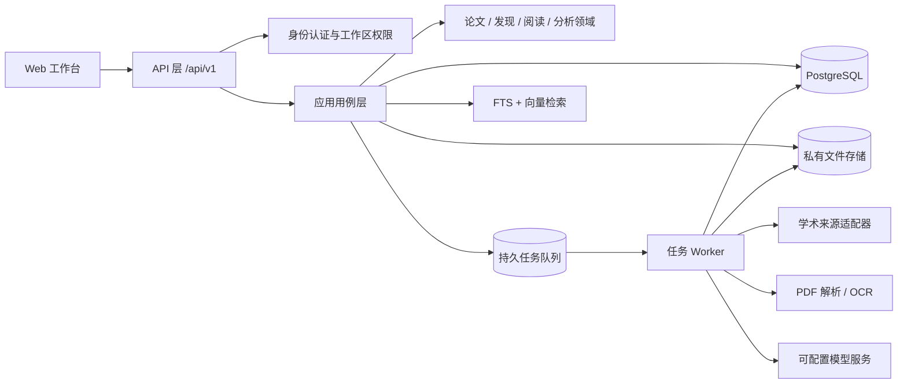

# LitLoom 多人研究生论文工作台：平台架构与论文分析设计

版本：1.1（多人版目标架构）
状态：当前应用已切换到 PostgreSQL；本机共享工作区可用，多租户隔离与网络团队部署仍未完成
适用项目版本：LitLoom 0.19.0 起的后续演进

## 1. 目标与边界

把现有个人研究工作台逐步演进为可以由个人、课题组和多个研究团队长期使用的平台。平台覆盖论文发现、去重、分诊、阅读、全文证据、跨论文分析、协作、自动追踪、迁移和运维。多年积累的数据必须能追溯、能导出、能恢复；AI 产物必须能回到论文版本与原文证据。

目标不是一次性把代码拆成微服务，也不是把“大模型回答”当作论文分析。保持模块化单体；PostgreSQL 数据访问层、初始数据迁移和索引已接入，后续重点是租户隔离与安全团队部署，再把长任务迁至持久 worker；只有单个模块确有独立扩缩容、隔离或发布需求时，才将它拆成服务。

本设计同时区分三类事实：

- **当前能力**：本地模块化单体；PostgreSQL schema 19；已有论文检索、候选审核、阅读/精读、PDF 证据、任务、PostgreSQL dump 备份和本机账号功能。SQLite 保留作数据迁移来源与兼容测试后端。
- **当前限制**：PostgreSQL 运行版目前是单机共享工作区；隔离租户所需 RLS/事务级工作区上下文未实现，服务默认仅监听回环地址。当前功能不等于可供多人网络访问的 PostgreSQL 协作部署。
- **目标能力**：多人工作区、对象级权限、团队共享馆藏、可审阅的全文结构化分析、证据矩阵和安全的异步 Agent 工作流。

## 2. 架构决策摘要

| 领域 | 推荐决定 | 主要原因 |
|---|---|---|
| 应用形态 | 模块化单体 + 独立 worker 进程 | 便于事务、调试和本地/单机部署，也允许异步任务独立伸缩 |
| HTTP 层 | FastAPI，版本化 REST API；OpenAPI 是契约 | 请求校验、依赖注入、认证中间件、文档和集成测试更清晰 |
| 主数据库 | 多人版使用 PostgreSQL；SQLite 继续支持个人离线版和导入导出 | 需要并发写入、行级权限、可靠迁移和 JSON/全文扩展 |
| 异步任务 | PostgreSQL 持久任务表作为第一步；规模上升后接 Redis + Celery/RQ/Arq | 任务要可恢复、幂等、可取消；不能阻塞 API 请求 |
| 文件 | 私有对象存储接口；单机可用本地目录，团队部署用 S3 兼容存储 | PDF 与数据库解耦，权限由服务签发，支持校验和生命周期管理 |
| 搜索 | PostgreSQL FTS + pgvector 混合检索起步；索引可重建 | 先保证可解释、低运维和租户过滤，再依据规模引入专用搜索服务 |
| 前端 | 先保留现有静态前端并按功能模块拆分；复杂协作成熟后再评估 SPA | 不让 UI 重写阻塞后端数据隔离与分析能力 |
| AI | 通过 provider adapter 接入；抽取、检索、验证、写报告是分阶段工作流 | 防止模型供应商锁定；每一步都能记录、评估和人工复核 |

## 3. 目标系统边界



模块化单体共享一套领域模型、迁移和权限策略。API 进程负责校验、鉴权、短事务和任务投递；worker 负责耗时的来源抓取、PDF 解析、embedding 和模型分析。第三方连接器与模型调用均有超时、限流、重试预算、错误分类和运行记录。

## 4. 标准代码结构

建议采用 `src/` 布局和明确的依赖方向：接口层可以调用应用层，应用层依赖领域规则与端口，基础设施实现端口；领域层不得导入 HTTP、SQLAlchemy、云存储 SDK 或模型 SDK。

```text
src/literature_desk/
  __init__.py
  main.py                    # API 应用装配和启动
  cli.py                     # migrate、导入、导出、备份、运维命令
  core/
    config.py                # 环境配置与启动校验
    security.py              # 密码、token、CSRF、加密工具
    errors.py                # 稳定的应用错误类型
    logging.py               # 脱敏结构化日志与 request_id
    telemetry.py             # 指标与 tracing 接口
  domain/
    identity/                # User、Membership、Role
    workspace/               # Workspace、Project、权限策略
    papers/                  # Work、Edition、Identifier、版本关系
    discovery/               # Query、SourceObservation、Match、Feedback
    reading/                 # Collection、Annotation、ReadingSession、Note
    analysis/                # Claim、EvidenceSpan、Method、Experiment 等
    agents/                  # Workflow、Run、Step、人工审批规则
    common/                  # ID、时间、值对象、领域事件
  application/
    ports/                   # Repository、Clock、FileStore、Model、Queue 接口
    commands/                # 创建/更新/导入/审阅等写用例
    queries/                  # 搜索/列表/比较/分析等读用例
    services/                 # 事务边界、授权上下文、工作流编排
    workflows/                # 发现、解析、分析、比较、报告
  infrastructure/
    db/                       # ORM model、session、repository 实现
    migrations/               # Alembic 版本化迁移
    sources/                  # OpenAlex、arXiv、Crossref 等 adapter
    documents/                # PDF、OCR、GROBID/版面解析 adapter
    ai/                       # LLM provider、embedding、prompt registry
    files/                    # 本地/S3 对象存储实现
    search/                   # PostgreSQL FTS、pgvector 实现
    jobs/                     # outbox、队列与锁
  interfaces/
    http/api_v1/              # 按 papers、workspaces、analysis 等分路由
    http/dependencies.py      # DB、用户、工作区、权限依赖
    http/schemas/             # 输入输出 DTO，不复用数据库实体
    http/middleware.py        # request_id、安全头、限流和异常映射
  workers/
    discovery_worker.py
    document_worker.py
    analysis_worker.py
    notification_worker.py
  static/                     # 现有静态 UI；保持与 API 分层
tests/
  unit/                       # domain/application 规则
  integration/                # PostgreSQL、对象存储、来源 adapter
  api/                        # HTTP 鉴权与契约测试
  tenancy/                    # 跨工作区隔离与 IDOR
  migrations/                 # SQLite -> PostgreSQL 数据升级
  evaluation/                 # 检索、抽取、证据定位评测集
  fixtures/                   # 脱敏论文和解析样例
alembic.ini
pyproject.toml
Dockerfile
compose.yaml                  # 开发环境 Postgres/Redis/MinIO
```

代码规则：

1. 路由函数只做输入校验、认证授权、调用用例和组装响应；不内嵌复杂 SQL 或连接器逻辑。
2. 所有写操作经由应用用例，在明确事务内完成；数据库连接不跨请求或任务持有。
3. 对外 API schema、领域实体、ORM 模型分开，数据库字段变化不自动成为 API 破坏性变化。
4. 每个模块定义公开服务/端口；禁止跨模块直接读取其他模块的私有表或 helper。
5. 用例名称体现用户动作，如 `CreateWorkspace`、`ReviewClaim`、`RunPaperAnalysis`；避免堆叠无职责的 `utils.py`。
6. 大型任务以持久化状态机表示；API 返回 job ID，前端轮询或订阅进度。
7. 先迁移现有单体中的稳定职责，保持兼容导入；每一小步均有行为测试，不进行一次性整仓重写。

## 5. 多人身份、工作区和权限

### 5.1 使用层级

```text
User
  ├── Personal Workspace（注册/迁移时自动创建，默认仅本人可见）
  └── Organization / Lab
        ├── Workspace（课题组或项目边界）
        │     ├── Projects / Topics / Saved Queries
        │     ├── Library Items / Notes / Evidence / Analyses
        │     └── Members
        └── Organization-level settings and audit
```

用户可以加入多个课题组。组织管理成员和默认策略，工作区隔离研究资料；单篇论文的共享以“加入工作区馆藏”表达。创建者离组或离职不能导致团队资料丢失，工作区所有权转移必须明确记录。

### 5.2 角色与授权

| 角色 | 典型权限 |
|---|---|
| Owner | 工作区所有设置、成员/角色管理、数据导出和删除、所有业务能力 |
| Admin | 邀请成员、管理项目/主题、配置连接器与策略；不能绕过敏感数据导出审批 |
| Researcher | 搜索、入库、阅读、编辑共享笔记、创建/审阅分析和比较 |
| Reviewer | 对论文、Claim、证据和分析提出评论/审阅；按策略只读正文 |
| Viewer | 查看有权访问的共享资料和报告，不修改、不发起有成本的任务 |

权限最终由“用户 + 工作区成员关系 + 资源范围 + 动作”决定，不能仅靠隐藏前端按钮。服务端每个对象读取、修改、下载和异步任务执行前都重新校验权限。角色权限用集中策略表/代码表达；后续可加资源级分享，但第一阶段避免任意 ACL 带来的难以审计和难以撤权。

私有笔记默认归用户本人；共享笔记显式标记为 workspace 范围。个人空间导入课题组时，系统提供预览清单和字段级范围选项，不自动把私人笔记、查询历史、PDF 或模型配置共享。

### 5.3 认证和会话

- 生产优先支持 OIDC / OAuth 2.1（学校或机构身份提供商），保留邮箱邀请和安全的登录回调；ORCID 可用于学术身份关联，不作为唯一授权依据。
- 若本地密码登录被启用：Argon2id 哈希、验证邮件、密码重置一次性 token、MFA/TOTP、登录速率限制和异常登录审计。
- Web 会话使用随机不透明 session cookie，`HttpOnly`、`Secure`、`SameSite=Lax/Strict`；写请求有 CSRF 防护。刷新或提升权限时轮换 session，退出后服务端撤销。
- API token 仅供明确的集成/CLI 使用，可设 scope、过期时间和撤销状态；不得将浏览器长期 bearer token 存在 localStorage。
- Cookie 与反向代理配置必须按部署模式验证；非本机部署强制 HTTPS 和安全 Host/Origin 校验。

### 5.4 租户隔离

- 请求开始时解析活动 `workspace_id`，从已认证用户的 Membership 校验；客户端传来的 workspace ID 不是授权凭证。
- 所有用户生成、工作区内的表都有非空 `workspace_id`（或明确的 `user_id` 私有范围）；唯一键、索引和外键包含租户边界。
- PostgreSQL 建议对核心工作区表启用 Row Level Security。每个事务先设置当前 user/workspace 上下文，事务结束自动清理；连接池必须使用事务级上下文，避免上下一个请求复用到错误租户。
- Repository 方法显式接收 `WorkspaceContext`；不允许 `get_paper(id)` 这种没有租户上下文的业务方法。
- 文件对象键按随机 ID 命名，不含原始文件名或用户信息；下载经鉴权后由服务流式返回或签短时私有 URL。禁止使用公开 bucket。
- 后台任务记录 tenant/workspace、发起用户、授权快照和用途；执行时确认工作区仍存在且任务仍有权限。移除成员后撤销其会话与待用下载链接。

## 6. 论文和工作区数据模型

将“规范论文身份”和“某团队如何使用论文”分开，减少公共元数据重复，同时避免共享私有查询和笔记。

### 6.1 规范论文目录与私有观察

- `works`：内部稳定 ID 表示研究工作/概念身份。
- `editions`：预印本、会议版、期刊扩展版、修订版、勘误/撤稿版本；每版有题名、摘要、发表状态和日期。
- `external_identifiers`：规范 DOI、arXiv、OpenAlex、Crossref 等外部 ID；唯一约束仅对明确可规范化的 ID 生效。
- `work_relations`：`preprint_of`、`extends`、`corrects`、`retracts`、`version_of` 等关系，保存来源和确认状态。
- `metadata_observations`：每个公共来源的字段快照、采集时间、source record ID 和字段级 provenance；刷新来源数据不覆盖人工定稿。
- 共享规范目录只保存可从公开来源获取的论文元数据。若某团队导入了私有或未发表文档，则存放在该工作区私有命名空间，不进入跨租户公共缓存。

### 6.2 工作区馆藏与研究记录

核心工作区表建议包括：

| 表 | 关键字段与用途 |
|---|---|
| `users` | 登录身份、状态、显示名、创建时间、删除/匿名化状态 |
| `organizations` | 课题组/机构信息、默认安全策略、所有者 |
| `workspaces` | 组织或个人空间、名称、可见性、保留策略、创建者 |
| `workspace_memberships` | `workspace_id + user_id`、role、邀请/加入/撤销时间 |
| `projects` / `topics` | 研究项目、领域问题、术语与主题生命周期 |
| `library_items` | `workspace_id + work_id`、状态、收藏、加入原因、创建者、更新时间 |
| `collections` / `tags` | 工作区集合和标签；关系使用独立 join 表 |
| `saved_queries` / `query_revisions` | 查询规则版本、来源、频率、创建者和状态 |
| `search_runs` / `source_observations` / `query_matches` | 私有检索历史、来源健康、命中路径、分数版本和反馈 |
| `notes` / `annotations` / `reading_sessions` | 私人或共享范围、作者、编辑版本、页码锚点与活动记录 |
| `attachments` / `document_artifacts` | 工作区归属、内容哈希、存储 key、许可/来源、解析版本 |
| `analysis_runs` / `claims` / `evidence_spans` | AI 草稿、人工确认结论及其证据锚点 |
| `audit_events` | 工作区范围内的登录、权限、导出、共享、删除和任务事件 |

### 6.3 数据约束

- `library_items` 可用 `(workspace_id, work_id)` 唯一；允许同一研究工作进入多个不同工作区。
- 工作区内容表以 `(workspace_id, id)` 或对应组合键作为候选键，跨表外键带上 `workspace_id`，从结构上拒绝把 A 工作区的笔记挂到 B 工作区的论文。
- 私人记录至少保存 `owner_user_id`；私人范围的所有者必须属于访问工作区，分享时创建带审计的共享版本或显式更改 scope。
- 对不可变事实使用 append-only observation/revision；业务状态只在专门的 workspace association 中更新。
- 删除工作区采用可恢复软删除与延迟硬删除流程；先撤销访问，完成导出/保留策略后再清理对象存储和数据库。
- 个人反馈、研究画像和推荐模型按用户保存；团队共享的排序偏好按 workspace 保存，二者不互相覆盖。

## 7. 论文分析功能设计

### 7.1 用户可用的分析工作流

1. 选择一篇论文或一个工作区集合；查看文件许可、页数、文件哈希、提取质量和已有分析版本。
2. 选择分析模板：快速摘要、方法/实验拆解、复现性检查、研究生精读、组会汇报、跨论文比较或系统综述证据提取。
3. 任务异步执行，展示解析、抽取、证据校验、人工复核各阶段；用户可取消、重试失败步骤或以新模型/新提示重跑。
4. AI 结果显示为未确认草稿。用户可以接受、编辑、驳回或标记争议；人工修订保留为独立 revision，后续重跑不得覆盖。
5. 每项结构化结论都能打开来源页、段落/位置和原文片段；低质量扫描页或证据缺失时明确显示不确定。
6. 比较分析把论文版本、实验条件和单位并排显示；不能直接比较的指标明确标注“不可比”，不能合并成单一排名。

### 7.2 文档解析流水线

```text
上传/合法导入
  -> 文件类型/大小/恶意内容检查
  -> SHA-256 去重与对象存储
  -> PDF 文本层与布局解析
  -> 低文本密度页 OCR
  -> 页/节/段落/表格/公式标注
  -> 结构感知分块与解析质量评估
  -> FTS/embedding 索引
  -> 研究者确认版本和元数据
```

解析器通过 `DocumentParser` 端口接入。初期用现有逐页文本结果保留兼容；后续评估 GROBID、Docling、Tesseract 或 OCRmyPDF 等可替换工具。表格/公式应保留原始页面坐标与解析文本，不能把格式化丢失的文本当作可靠实验数据。任务保存解析器名称/版本、语言、页数、空白页/低质量页、耗时和警告；解析产物可从原 PDF 重建。

上传内容视为不可信数据：限制大小/页数/解压比，校验 MIME 与文件签名，异步扫描，禁用 PDF 中的脚本/外链动作。遵守版权和机构许可，不绕过付费墙；删除文件后按保留策略清除副本、文本和向量索引。

### 7.3 结构化分析模型

每次分析建立不可变的 `analysis_run`，记录输入 edition、附件 hash、parser version、抽取 schema version、模型/provider、prompt version、参数、用量、成本、开始结束时间和状态。核心实体：

| 实体 | 内容 |
|---|---|
| `paper_analyses` | 对单一论文版本的结构化分析版本、模板、语言和总体质量 |
| `claims` | 论文作者或 AI 对研究问题、贡献、结果、局限、因果关系等的声明；区分作者原文陈述与模型推断 |
| `evidence_spans` | 精确原文、附件/版本 hash、页码、章节、块 ID、字符偏移/坐标、摘录 hash、抽取质量 |
| `methods` | 方法类别、组件、假设、训练/推理流程、超参数和来源证据 |
| `datasets` | 数据集名称/版本、规模、拆分、来源与许可；规范数据集 ID 和原文别名分开 |
| `experiments` | 研究问题、设置、对照、硬件/算力、随机种子、消融和环境 |
| `metrics` | 名称、数值、单位、方向、数据集/子集、统计范围和基线；原始字符串及规范值并存 |
| `limitations` | 作者明确承认的局限与系统推断的风险分别记录 |
| `reproducibility_items` | 代码、数据、模型、环境、协议、算力、随机种子、许可证、可访问链接及状态 |
| `analysis_reviews` | 审阅人、字段、决定、修改 diff、原因和时间 |

每个 AI 字段都保存 `origin`（author_text / model_extracted / human_verified / human_authored）、`confidence`、`review_status`、`analysis_run_id` 和至少一个支持证据或“无直接证据”原因。模型推断不能伪装为论文作者事实。置信度是抽取器信号，不是正确率保证。

EvidenceSpan 锚点使用不可变附件 hash + 页序号 + 章节/块 ID + 字符偏移/坐标 + 精确引用文本 hash。PDF 重解析后以新 parser version 新建 anchor mapping；不悄悄移动旧证据。用户可以确认或修正页码，系统需区分 PDF 物理页与论文印刷页码。

### 7.4 证据核验与问答

- RAG 只在当前用户可访问的工作区集合中检索；权限过滤必须在 lexical/vector 检索之前进入数据库查询。
- 检索组合标题/元数据、章节、BM25/FTS 和多语言 embedding；界面展示命中块、分数组成和 PDF 页锚点。
- 答案按 claim 列出引用，引用对象直接引用 EvidenceSpan ID 和版本；后端再核对引用确实属于该回答允许访问的附件。
- 可设置“仅引用直接证据”或“允许跨论文综合”；综合结论同时显示支持、反证、样本数和适用条件。
- 无来源支持、解析失败或数据冲突时，返回“当前资料无法确认”并给出缺口，不让模型补全页码或编造引文。
- 对答案做自动引用存在性/文本匹配检查和基于人工标注集的抽样评估；评估不过的模型/提示版本不得成为默认模板。

### 7.5 跨论文比较与研究综合

比较对象按具体 research question/主题保存，字段模板可按学科扩展。默认矩阵包含：研究问题、任务、数据集/拆分、方法、基线、指标、实验设置、主要结果、限制、代码/数据和证据链接。

- 对数字结果按数据集版本、数据拆分、指标定义、单位、硬件/协议和统计方法匹配后再并列；缺少条件时标为无法公平比较。
- “支持/反驳/补充/无关”关系需链接到两端 claim 和 evidence；冲突不会被压平成单一结论。
- 研究空白、趋势、影响关系作为综合推断，保留生成规则、支持/反证论文、检索时间窗和人工审阅状态。
- 导出为 Markdown、CSV/TSV、JSON/CSL JSON；系统综述工作流额外支持筛选理由、排除日志、重复记录和 PRISMA 风格计数，但不声称自动完成系统综述。

## 8. Agent 与异步工作流

### 8.1 角色拆分

- **Planner**：把问题拆成可执行检索/分析步骤，产生查询和预算，不直接改用户资料。
- **Searcher**：调用有速率限制的公开学术源，保存来源级结果和失败。
- **Identity Resolver**：匹配 DOI、预印本和版本关系；不确定匹配进入人工复核。
- **Ranker/Triage**：解释主题匹配、重复历史、领域邻接和排序理由。
- **Document Analyst**：解析和抽取方法、数据、指标、结果、局限及证据锚点。
- **Evidence Verifier**：核对引文锚点、文本是否支持 claim、页码是否有效；无法核验则降低状态。
- **Comparison Analyst**：对齐条件并生成对比表/冲突集合，不擅自裁定哪项结果正确。
- **Report Writer**：按模板生成带引用链接的研究简报、阅读路线或组会卡片。
- **Human Review**：对合并、排除、共享、结论确认和有外发成本/隐私风险的动作进行审批。

### 8.2 状态、幂等与权限

每个 workflow run 按持久状态机工作：`queued -> running -> waiting_for_review / succeeded / failed / cancelled`；每步有输入输出 hash、尝试次数、日志摘要、耗时和可重试标志。步骤使用幂等键（workspace + job type + input hash + version），重复投递不会重复写结果。自动重试只覆盖限流、网络和暂时性基础设施错误；格式错误和证据校验失败需可见，不能无限重试。

Agent 的 tool allowlist 按角色和 workspace policy 控制。初期允许读取、搜索、创建草稿、建议标签；删除、合并、拆分、对外分享、修改人工确认字段、导出完整私有数据必须由用户确认。来源 PDF、网页摘要和模型输出均为不可信文本，系统提示不得把文档中的指令当工具授权；工具层仍独立执行参数和权限校验。

### 8.3 成本与隐私

- 管理员可按 workspace 配置模型提供商、允许发送的数据类别、每日任务/Token 预算、并发上限、最大文件页数和保留期。
- 发往云模型前展示数据类别和目标服务；全文、私人笔记、未发表资料默认不外发。团队管理员不能覆盖用户明确的私有笔记范围。
- 记录估算/实际 token 与费用、模型版本和 provider request ID；不把 API key、完整私有 prompt 或凭据写入普通日志。
- 任务完成通知只显示最少元数据，详情仍需重新鉴权。

## 9. API 设计准则

多人版 API 统一放在 `/api/v1`，所有工作区资源显式带工作区路径或上下文：

```text
/api/v1/auth/*
/api/v1/me
/api/v1/organizations
/api/v1/workspaces/{workspace_id}/members
/api/v1/workspaces/{workspace_id}/projects
/api/v1/workspaces/{workspace_id}/topics
/api/v1/workspaces/{workspace_id}/papers
/api/v1/workspaces/{workspace_id}/search-runs
/api/v1/workspaces/{workspace_id}/papers/{paper_id}/analysis-runs
/api/v1/workspaces/{workspace_id}/comparisons
/api/v1/workspaces/{workspace_id}/jobs/{job_id}
/api/v1/workspaces/{workspace_id}/exports
```

- 列表使用稳定 cursor pagination，支持排序键和过滤器版本；避免 offset 在增长库上性能下降。
- 写接口支持 `Idempotency-Key`；长任务返回 `202 Accepted` + job ID；错误用固定问题码和 `request_id`。
- 更新共享笔记/分析使用 `ETag` 或版本号做乐观并发控制，冲突返回 409 并保留双方编辑。
- 不在 URL、日志或错误文本中泄露外部 access token、原始 prompt、隐私笔记或 PDF 路径。
- API contract 变化必须同步更新 `openapi.yaml` 与兼容性测试；旧单机 API 先标记 deprecated，保持一个明确迁移窗口。

## 10. 迁移与升级路径

迁移不能直接对唯一的真实 SQLite 文件做不可逆改写。当前本地数据库、附件和备份是多年资产；首版多人迁移必须采用“复制、演练、校验、切换”的方式。

### 阶段 0：建立安全基线

1. 确认当前应用版本、schema、论文/来源/笔记/附件数量和最新完整备份。
2. 对真实数据库做只读盘点；导出演练到独立测试目录，校验 SHA-256、外键、FTS 重建和附件可读性。
3. 将当前测试样本脱敏，建立迁移 golden fixture；禁止把真实全文或笔记提交到 Git。

### 阶段 1：代码模块化，保持行为兼容

1. 为现有核心流程补行为/HTTP contract 测试和明确的 SQLite repository 接口。
2. 按 `domain -> application -> infrastructure -> interfaces` 顺序下沉函数；先搬纯规则，再搬查询/用例，再拆 HTTP 路由。
3. 在 CI 保持现有验证结果和个人模式启动方式；每批迁移都比较 API 主要字段、检索结果和导入导出/备份行为。
4. 不在结构重构中顺手改变去重、相关性或人工字段语义。

### 阶段 2：多人基础设施与隔离

1. 新建 PostgreSQL schema 和 Alembic 迁移；添加用户、组织、工作区、成员、角色和会话。
2. 先实现工作区解析和统一授权服务，再迁移任何业务 API；所有新表从创建时即带 tenant scope。
3. 引入审计、CSRF、限流、HTTPS 配置、私有附件存储和隔离测试。
4. 部署仅用于测试的多人实例，验证两个用户/工作区之间的 list/get/search/export/file/job/AI retrieval 均无越权。

### 阶段 3：SQLite 到个人工作区导入器

1. 导入器读取一致性 SQLite 快照和附件 manifest，目标是新建的 Personal Workspace。
2. 导入前输出预演报告：会创建的 work/edition/library item、模糊重复、缺失附件、无效字段和预计空间。
3. 映射 ID 时保留源 ID 到目标 ID 对照；保留来源快照、阅读卡、笔记历史、反馈、主题、查询、运行、审计时间及附件哈希。
4. 迁移完成执行数量、抽样内容、哈希、外键、全文索引与导出再导入比较；差异必须可解释。
5. 迁移失败只删除临时目标库或恢复目标环境快照，不碰原始 SQLite；用户验收后切换写入，保留原始库为只读归档。

### 阶段 4：异步分析与团队功能

先加持久任务表和单 worker，再接可横向扩展队列；按“解析质量 -> EvidenceSpan -> Claim review -> 单篇比较 -> 多论文综合 -> 报告/通知”推进。每一阶段都以证据定位和权限评测通过作为上线门槛，不以模型回答看起来完整作为验收。

## 11. 测试与质量门槛

### 必须长期运行的测试

- **领域单测**：外部 ID 规范化、版本关系、状态转换、权限矩阵、指标单位规范、证据锚点规则。
- **数据库集成测试**：PostgreSQL 迁移、唯一键/组合外键、事务回滚、并发更新和 RLS。
- **跨租户安全测试**：构造两个 workspace 的相同资源 ID 场景；验证 API、搜索、向量检索、文件下载、后台 job、导出和错误响应均无数据泄漏。
- **身份测试**：OIDC state/nonce、CSRF、session fixation、撤销成员、过期邀请、重置密码/MFA 与限流。
- **连接器 contract 测试**：脱敏 fixture、分页、限流/超时、字段缺失和重复响应；不依赖实时公共网络作为唯一门禁。
- **迁移测试**：由当前 SQLite schema 9 fixture 迁入全新 PostgreSQL；重复导入幂等；失败可重试；附件内容哈希一致。
- **分析评测**：分学科/文本质量分层的页码命中率、Claim 支持度、抽取完整率、人工修订率、引用伪造率；低 OCR 质量单独统计。
- **检索评测**：固定 query 集上的 Recall@k、nDCG@k、Precision@k、重复率、时间覆盖、来源成功率和新论文发现延迟。
- **前端可访问性**：键盘流程、屏幕阅读器标签、小屏幕、并发编辑冲突和长任务失败恢复。

### 建议初始发布门槛

- 任意工作区对其他工作区数据的未经授权访问：0 例；定期运行自动化 IDOR/RLS 测试。
- 数据恢复演练：数据库、笔记历史和附件哈希均通过；目标 RPO/RTO 在部署手册中明确。
- 所有正式 Claim 都能回到有效论文版本和证据锚点；目标抽样引用有效率至少 98%，错误归因单独跟踪，不以平均分掩盖严重问题。
- 论文分析对“无证据/低质量 OCR/不同版本/条件不可比”有显式状态；不能静默生成确定结论。
- 检索和分析模型版本切换前，在固定离线集上进行新旧比较；样本不足则标示“未评估”。
- 付费/私有全文发送、模型预算、数据导出和成员权限变化均有审计记录。

## 12. 安全、隐私与运维

- **密钥**：开发密钥用环境变量；生产用 Secret Manager/KMS；可轮换；不写数据库快照、应用备份、错误跟踪或普通日志。
- **数据库**：TLS 连接、最小权限服务账号、加密磁盘、自动备份和 PostgreSQL PITR；季度恢复演练。
- **附件**：私有 bucket、服务器端加密、下载鉴权、短时 URL、校验和、隔离扫描；按 workspace 保留策略执行删除。
- **审计**：记录用户、workspace、动作、目标、结果、request/job ID、时间和必要差异摘要；避免保存完整笔记/全文内容。
- **限流**：按用户、工作区、来源和模型分别限流；预算耗尽时停止新增昂贵任务但保证读取、导出与恢复。
- **监控**：API p50/p95/p99、5xx、数据库连接等待、队列年龄/失败率、来源健康、解析质量、模型费用和权限拒绝事件。
- **备份**：数据库、对象文件、配置导出分别定义 RPO/RTO；加密、跨故障域保存、保留版本和周期恢复测试。不能只在同一块磁盘上保留备份。
- **删除/导出**：工作区可导出开放格式和附件 manifest；删除有撤销期、法律保留策略和硬删除任务状态。
- **部署**：个人模式继续 loopback；团队版通过 TLS 反向代理、明确的 `PUBLIC_BASE_URL`、Trusted Proxy 列表、同站 cookie 和网络隔离运行。管理员 API 与普通用户 API 分离。

SLO 应按实际部署和使用量验证，不应把单机目标宣传成托管服务承诺。团队试点可先设目标：月可用性 99.5%；元数据读取 API p95 < 500 ms；工作区 10 万条馆藏下基本检索 p95 < 2 s（不含外部来源）；长任务排队、运行时间分别报告，不计入同步 HTTP 延迟。

## 13. 分阶段路线图与验收

| 阶段 | 交付范围 | 进入下一阶段的条件 |
|---|---|---|
| A. 清晰模块边界 | `src/` 包、领域/应用/基础设施/接口分层、测试分层、接口契约稳定 | 个人模式行为兼容；数据无损；核心逻辑不再依赖 HTTP handler 全局状态 |
| B. 多人基础 | Postgres、用户/组织/工作区、登录、邀请、RBAC、工作区范围、审计、私有文件 | 跨租户/API/搜索/附件/任务测试通过；迁移演练可重复；恢复完成 |
| C. 协作阅读 | 共享/私有笔记、评论、冲突处理、集合、成员通知、团队报告 | 分享范围可见可撤回；并发写入无静默覆盖；导出含来源信息 |
| D. 证据分析 | 新解析流水线、OCR、EvidenceSpan、结构化 claim、review UI、版本重跑 | 证据定位评测达到门槛；模型失败不会污染人工结论；任务可取消/重试 |
| E. 综合 Agent | 跨论文比较、矛盾分析、趋势/空白假设、定时简报、成本/预算策略 | 固定评测集持续通过；所有推断可追溯；人工审批和工作区预算生效 |
| F. 托管与生态 | 多实例 worker、对象存储、OIDC/机构部署、Zotero/开放 API、插件 | 安全审计、备份灾备、容量测试和版本兼容策略完成 |

每个阶段都应产生可用软件，而非先花数月做空架构。当前项目最合理的下一步是 A 阶段中的低风险模块化与契约测试；多人数据库迁移应作为有独立演练、独立部署配置的阶段 B，不能直接改造当前真实资料库。

## 14. 需要在团队试点前定下的策略

默认推荐：**单机构/课题组部署、OIDC 登录、工作区私有默认、明确邀请加入、云模型外发默认关闭、管理员逐工作区配置模型与配额、SQLite 个人数据先导入个人空间**。实际部署前要根据实验室要求确定：身份提供商、部署责任人、数据保留期限、模型服务商及数据处理条款、私有 PDF 许可、备份异地位置和删除审批流程。

这些是部署策略选择，不阻碍先完成代码模块化、数据模型、租户隔离测试和分析流水线设计。

## 15. 与现有文档的关系

- 当前功能与产品验收仍以 [`需求分析.md`](需求分析.md) 和 [`ARCHITECTURE.md`](ARCHITECTURE.md) 的“已实现/当前边界”为准。
- 本文说明多人平台与论文分析的目标架构、数据隔离、迁移路线和发布门槛。
- API 实施时以更新后的 `openapi.yaml` 为契约；部署和灾备规则落到 `OPERATIONS.md` 与 `SECURITY.md`。
- 每项重大技术决定进入 `ADR.md`，记录状态、替代方案、触发条件和迁移责任。
